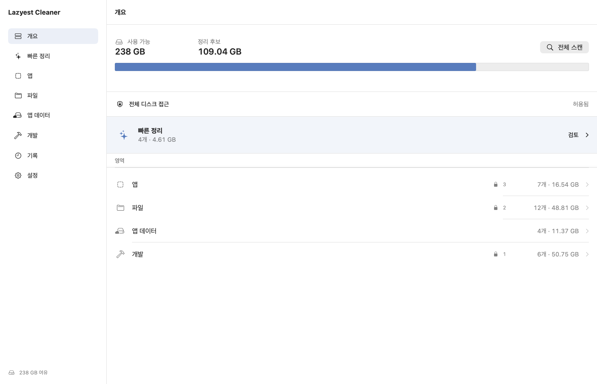
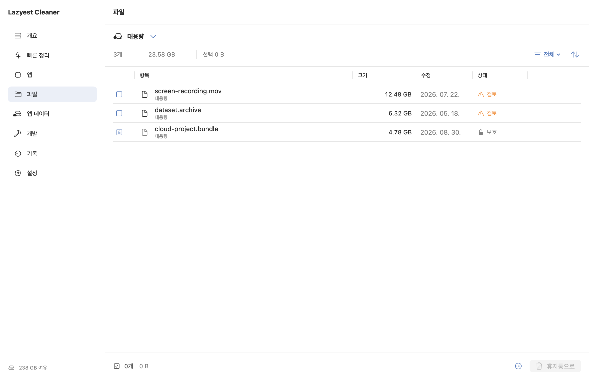

# Lazyest Cleaner

Lazyest Cleaner는 macOS 저장 공간을 한 창에서 스캔하고, 사용자가 확인한 항목만 정리하는 네이티브 SwiftUI 앱이다. macOS 14 이상과 Apple Silicon/Intel Mac을 지원한다.

현재 버전은 **1.1.1**입니다.





문서 이미지는 실제 콘텐츠 화면에 예시 데이터와 고정 사이드바를 조합한 렌더입니다. 개인 파일을 스캔하거나 계정 정보를 사용하지 않습니다.

## 주요 작업

| 영역 | 기능 |
| --- | --- |
| 빠른 정리 | 재생성 가능한 캐시와 로그를 우선 검토 |
| 앱 | 설치 앱, 읽기 전용 시스템 앱, 잔여 데이터 분리 |
| 앱 제거 | 앱만 삭제, 데이터만 삭제, 앱과 데이터 삭제를 별도 실행 |
| 파일 | 대용량, 오래된 파일, 중복, 다운로드, 데스크톱 영상, 사용자 지정 위치 |
| 앱 데이터 | 일반 캐시, 브라우저 캐시, 로그, 휴지통 |
| 개발 | 개발 도구 캐시와 Docker 미사용 리소스 |
| 기록 | 실행 시각, 방식, 처리 수, 용량, 성공/실패 수 저장 |

스캔 중에도 기존 결과와 화면 구조를 유지한다. 검색, 정렬, 필터, 다중 선택, Finder 열기, 사용자 보호 규칙을 모든 작업군에서 같은 방식으로 제공한다.

## 안전 원칙

- 일반 파일과 앱은 macOS 휴지통으로 이동한다.
- 즉시 삭제와 휴지통 영구 삭제는 별도 설정 및 강화 확인을 요구한다.
- 민감 항목과 Docker 정리는 확인 체크를 거쳐야 실행된다.
- 실행 직전에 경로, 심볼릭 링크, 보호 규칙, 실행 중 앱, Docker 상태를 다시 검사한다.
- 시스템 경로, 홈 루트, 클라우드 저장소, Keychain, Mail, Messages, Photos 보관함과 주요 자격증명 경로는 기본 보호한다.
- Docker VM 디스크를 파일로 직접 삭제하지 않고 Docker가 보고한 미사용 리소스에만 prune을 실행한다.
- 연결 앱 데이터는 번들 ID, 코드 서명 앱 그룹, 정확한 이름 일치, 검증된 매니페스트로만 찾는다.

전체 디스크 접근 권한은 macOS 시스템 설정에서 사용자가 직접 허용해야 한다. 권한이 없으면 제한 영역은 빠르게 건너뛰고 앱 안에서 설정 위치를 바로 열 수 있다. 시스템 앱과 Docker는 기본 전체 스캔에서 제외되며 설정에서 포함할 수 있다.

## AI Agent 설치

소스 저장소 접근 권한이 있는 계정에서 사용자가 설치를 요청했다면 아래 한 명령으로 최신 소스를 임시로 받아 빌드하고 `/Applications/Lazyest Cleaner.app`에 설치한 뒤 실행한다.

```sh
(workdir="$(mktemp -d)" && trap 'rm -rf "$workdir"' EXIT && git clone --depth 1 --quiet https://github.com/lazyest-hyun/lazyest-cleaner.git "$workdir" && "$workdir/script/build_and_run.sh" install)
```

처음 설치하면 자동 스캔은 꺼져 있습니다. 사용자가 스캔과 정리 항목을 직접 선택합니다. 기존 버전에서 업그레이드하면 보호 경로와 사용자 설정, 정리 기록을 보존합니다. 새 bundle ID는 `com.lazyest.cleaner`이므로 기존 사용자는 필요한 경우 시스템 설정에서 새 앱에 전체 디스크 접근 권한을 다시 허용해야 합니다.

## 설치와 배포 상태

2026년 9월 7일 기준 **1.1.1 Apple Silicon·Intel 공용 DMG**를 로컬에서 준비하고 앱·DMG의 Developer ID 서명, Apple 공증, 스테이플과 Gatekeeper 검증을 완료했습니다. 이 새 버전은 아직 공개 GitHub Release에 게시하지 않았습니다. 공개 페이지에 남아 있는 PKG는 이전 버전이며 이번 DMG와 다릅니다.

공개되면 DMG와 SHA-256 체크섬을 확인한 뒤 앱을 `/Applications`로 옮겨 실행합니다. 지금 소스에서 설치하려면 위 설치 명령을 사용합니다.

## 로컬 빌드 및 검증

요구 사항:

- macOS 14 이상
- 앱 빌드: Swift 6을 포함한 Xcode Command Line Tools
- XCTest 테스트 실행: 전체 Xcode의 XCTest 프레임워크. Command Line Tools만 설치된 Mac에서는 앱 빌드가 가능하지만 테스트 모듈이 없을 수 있습니다.

```bash
DEVELOPER_DIR="/Applications/Xcode.app/Contents/Developer" swift test --disable-sandbox
./script/build_and_run.sh build
./script/build_and_run.sh install
```

`build`는 현재 기기의 release 앱을 만들고 실행 중인 앱을 건드리지 않습니다. `install`만 검증된 앱을 `/Applications`에 교체하고 실행합니다. 복사가 실패하면 기존 앱을 복구합니다.

유니버설 앱과 ZIP 패키지 생성:

```bash
./script/build_and_run.sh --package
```

결과는 `dist/Lazyest Cleaner.app`과 `dist/Lazyest-Cleaner-<version>-universal.zip`에 생성된다. 스크립트는 사용 가능한 Developer ID 또는 Apple Development 인증서를 우선 사용하고, 인증서가 없으면 로컬 검증용 ad hoc 서명을 적용한다. 외부 배포에는 별도의 Developer ID 서명과 Apple 공증이 필요하다.

현재 DMG 배포 절차는 아래 `DMG 패키지`를 사용합니다. 별도 PKG가 필요한 배포자는 Developer ID Installer 인증서와 Keychain 공증 프로필까지 준비한 뒤 아래 선택 절차를 사용할 수 있습니다. 인증 값은 저장소에 기록하지 않습니다.

```bash
CLEANER_CODESIGN_IDENTITY="Developer ID Application: ..." \
CLEANER_INSTALLER_IDENTITY="Developer ID Installer: ..." \
CLEANER_TEAM_ID="..." \
CLEANER_NOTARY_PROFILE="lazyest-notary" \
./script/package_macos_release.sh --preflight

CLEANER_CODESIGN_IDENTITY="Developer ID Application: ..." \
CLEANER_INSTALLER_IDENTITY="Developer ID Installer: ..." \
CLEANER_TEAM_ID="..." \
CLEANER_NOTARY_PROFILE="lazyest-notary" \
./script/package_macos_release.sh
```

완료되면 `dist/Lazyest-Cleaner-<version>-universal.pkg`와 SHA-256 파일이 생성된다. 이 스크립트는 GitHub 태그나 Release를 만들지 않는다.

## 구조

- `Models`: 작업군, 항목, 위험, 액션, 설정 계약
- `Services`: 앱/파일/Docker 탐색, 보호 판정, 실행 전 검사와 정리 실행
- `Stores`: 화면 상태, 스캔 오케스트레이션, 액션 준비, 실행 흐름
- `Views`: 단일 창, 표, 상세, 설정, 확인 시트와 공용 컴포넌트
- `Tests`: 파서, 스캐너, 보호, 실행, UI 심볼, 실제 환경 성능 경계

세부 제품 경계는 [PRODUCT_ARCHITECTURE.md](PRODUCT_ARCHITECTURE.md), 시각 규칙은 [DESIGN.md](DESIGN.md), 개인정보 처리는 [PRIVACY.md](PRIVACY.md), 보안 모델은 [SECURITY.md](SECURITY.md)를 따른다.

## 처음 사용하는 순서

1. 개요에서 `전체 스캔`을 누르거나 왼쪽에서 필요한 영역을 선택합니다.
2. 파일 이름과 용량을 검토하고 정리할 항목만 선택합니다. 보호 표시가 있는 항목은 정리할 수 없습니다.
3. 하단 버튼을 누른 뒤 확인 창에서 실제 처리 방식을 다시 확인합니다. 기본 파일 정리는 휴지통으로 이동합니다.
4. 작업 결과는 `기록`에서 확인합니다. 추가 설명은 항목과 버튼의 툴팁에서 볼 수 있습니다.

문서 화면은 디스크 스캔 없이 재생성할 수 있습니다.

```sh
swift build --disable-sandbox
.build/debug/LazyestCleaner --export-preview docs/images
```

예전 제품 이름은 기존 설정과 기록을 옮기거나 식별자가 일치하는 이전 앱을 제거하는 호환 코드에만 남아 있습니다. 현재 화면, 새 저장 경로, 배포 파일에는 Lazyest Cleaner 이름을 사용합니다.

### DMG 패키지

현재 배포 형식은 DMG입니다. Developer ID Application으로 서명한 앱을 준비하면 Installer 인증서 없이 패키징할 수 있습니다. 이 명령은 앱과 DMG를 각각 Apple에 공증하고 Gatekeeper 검사를 통과한 파일 및 상대 경로 SHA-256 체크섬을 남깁니다. 공개 업로드는 수행하지 않습니다.

```sh
LAZYEST_CODESIGN_IDENTITY="Developer ID Application: <publisher> (<team-id>)" \
LAZYEST_NOTARY_PROFILE="lazyest-notary" \
scripts/package-dmg.sh "$PWD/dist/Lazyest Cleaner.app" "$PWD/dist/Lazyest-Cleaner-macOS.dmg"
```

DMG를 열고 앱을 Applications로 옮긴 뒤 `/Applications`의 앱을 실행합니다. 현재 검증한 1.1.1 DMG는 Apple Silicon·Intel 공용입니다. 다른 CPU용 배포를 추가하려면 해당 빌드와 실행을 별도로 검증해야 합니다. 소스 변경 후에는 앱을 다시 빌드하고 서명해야 합니다.
